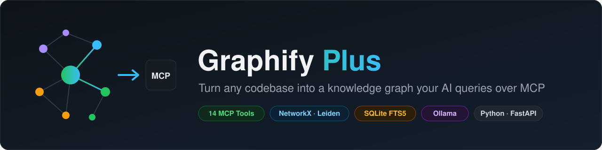
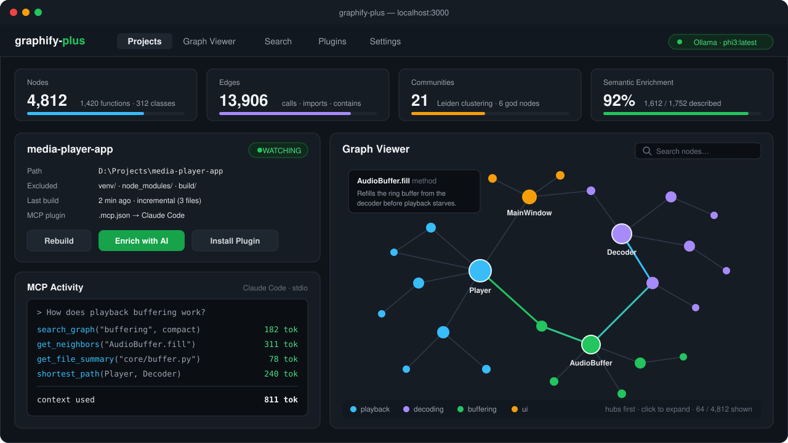
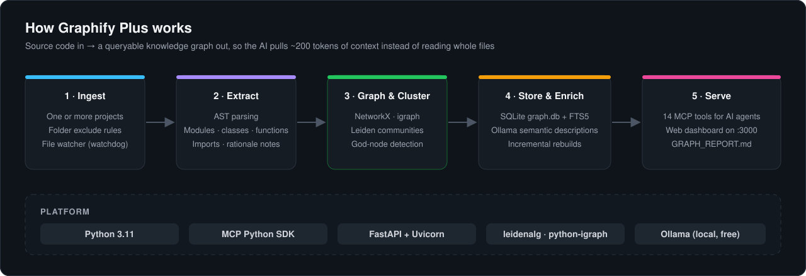

<p align="center">
  
</p>

<p align="center">
  
  
  
  
  
  
</p>

# 🕸️ Graphify Plus

**Stop wasting tokens. Give your AI the exact context it needs, nothing more.**

Graphify Plus is an intelligent context-engine designed to drastically minimize token usage when working with LLMs like GPT, Codex, and other AI coding assistants. By building dynamic knowledge graphs and integrating natively with the Model Context Protocol (MCP), Graphify Plus ensures your AI understands your codebase deeply without hitting context limits.

<p align="center">
  
  <br><sub>The web dashboard (localhost:3000): project stats, Ollama enrichment, the progressive graph viewer and the MCP tool calls an AI assistant makes. Illustrative mockup with sample data.</sub>
</p>

## ✨ Key Features

- 🪶 **Token Minimization:** Intelligently filters and compresses context, sending only the most relevant code and data to GPT, Codex, and other models. Save money and avoid context-window limits.
- 🕸️ **Dynamic Graph Building:** Automatically maps your codebase, dependencies, and logic flows into an interactive knowledge graph. 
- 🔌 **Native MCP Server Integration:** Seamlessly connects to Model Context Protocol (MCP) servers, allowing AI agents to query your graph in real-time.
- 🔗 **Multi-Project Connectivity:** Easily link multiple repositories and projects together. Graphify Plus understands the relationships across your entire ecosystem, not just a single folder.

## 🧠 How It Works

<p align="center">
  
</p>

Traditional AI coding tools dump entire files into the prompt, wasting thousands of tokens on irrelevant boilerplate. 

**Graphify Plus** changes the game:
1. **Ingests** your project(s) and analyzes the structure.
2. **Builds** a lightweight graph of relationships, dependencies, and core logic.
3. **Connects** to your AI via an MCP server.
4. **Serves** only the specific "nodes" (files, functions, classes) the AI needs to solve your current problem.

## 🚀 Getting Started

*(Note: Update these instructions based on your actual tech stack - e.g., Node.js, Python, etc.)*

### Prerequisites
- Node.js / Python (depending on your setup)
- An MCP-compatible AI client (like Cursor, Cline, or a custom Codex setup)

### Installation

```bash
# Clone the repository
git clone https://github.com/YOUR_USERNAME/Graphify-Plus.git
cd Graphify-Plus

# Install dependencies
npm install  # or pip install -r requirements.txt
